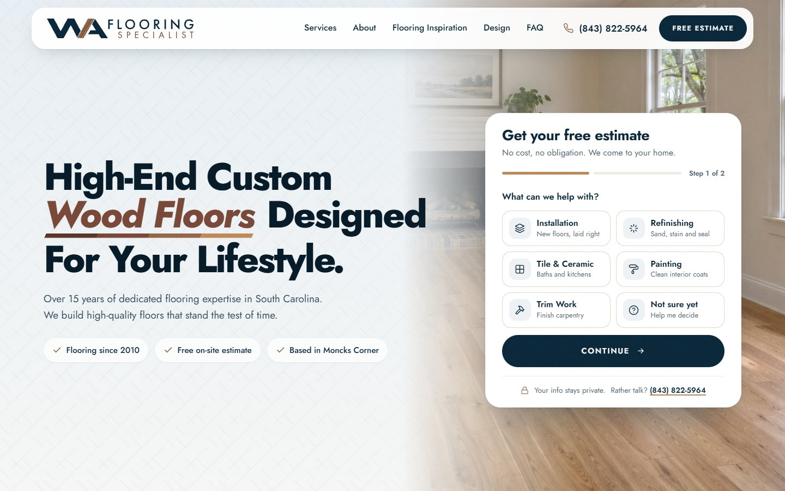
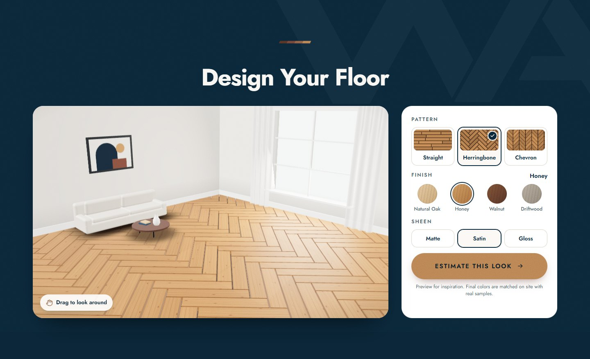
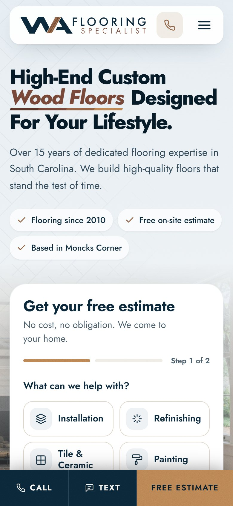

<div align="center">


# WA Flooring Specialist

**Site institucional one page para uma empresa de pisos em Moncks Corner, South Carolina (EUA).**
Feito para transformar tráfego do Google em pedidos de orçamento grátis por formulário, ligação ou SMS.

[](https://waflooring.escolats.com.br)


<br>



</div>

---

## Sobre o projeto

A **WA Flooring Specialist** (razão social WA Art In Wood Floor LLC) é uma empresa de pisos **liderada pelo próprio dono**, com base em Moncks Corner e atendimento na região de Charleston. A equipe trabalha com pisos desde 2010, e a empresa foi aberta em 2018. O carro-chefe é a **instalação de piso** e o **lixamento e restauração de madeira**, com acabamento, cerâmica e pintura como serviços complementares.

O público é o dono de casa americano que chega pelo Google no celular, comparando empresas antes de pedir orçamento. Por isso a página leva tudo para uma ação só: **pedir a visita gratuita**. O formulário fica já na primeira dobra, e no mobile uma barra fixa deixa Call, Text e Free Estimate sempre à mão.

O registro visual é **profissional e direto**, no nível das referências do segmento (LCG Boston, Fortunato Floors, Marquis Solutions, Gomes Roofing). A identidade nasce da **logo**: o "WA" em navy com a faixa de quatro madeiras no meio, que vira a régua de tábuas acima de cada título.

<table>
  <tr>
    <td width="68%"></td>
    <td width="32%"></td>
  </tr>
  <tr>
    <td align="center"><sub>Floor Designer: padrão, madeira e brilho em tempo real</sub></td>
    <td align="center"><sub>Mobile com barra fixa de contato</sub></td>
  </tr>
</table>

## Destaques

| | Recurso | Como funciona |
|---|---|---|
| 🪵 | **Floor Designer 3D (Three.js)** | Uma sala mobiliada em 3D onde o visitante troca o padrão (reto, espinha de peixe, chevron), a madeira (Natural Oak, Honey, Walnut, Driftwood) e o brilho (fosco, acetinado, brilhante). O botão **Estimate This Look** já leva a escolha para o formulário. |
| 📝 | **Orçamento em 2 passos** | No hero, o visitante toca no serviço e o formulário avança sozinho para nome, telefone e ZIP. Mais abaixo, um formulário completo com mapa da região. |
| 💬 | **Contato rápido no mobile** | Barra fixa com **Call**, **Text** (SMS com mensagem pronta) e **Free Estimate**. |
| 🛡️ | **Antispam** | Campo oculto, tempo mínimo na página, interação real, bloqueio de links e de emails descartáveis, e espera de 1 minuto entre envios. |
| 🖼️ | **Galeria com zoom** | Ambientes de inspiração com visualização em tela cheia, navegável pelo teclado. |
| 📱 | **Responsivo revisado** | Testado em 360, 390, 768, 1024, 1280, 1366, 1440 e 1920 px. O hero cabe inteiro na tela sem rolar. Serviços e depoimentos viram carrossel no celular. |
| ♿ | **Acessibilidade** | Áreas de toque de 44 px, foco visível, campos de 16 px no mobile (sem zoom no iPhone) e versão sem animação para `prefers-reduced-motion`. |

## Identidade visual

<table>
  <tr>
    <td align="center"><br><b>Navy</b><br><code>#0B2739</code></td>
    <td align="center"><br><b>Honey</b><br><code>#B98353</code></td>
    <td align="center"><br><b>Pecan</b><br><code>#8F6144</code></td>
    <td align="center"><br><b>Cedar</b><br><code>#734537</code></td>
    <td align="center"><br><b>Walnut</b><br><code>#563327</code></td>
    <td align="center"><br><b>Paper</b><br><code>#F8F6F2</code></td>
  </tr>
</table>

- **Tipografia:** [Jost](https://fonts.google.com/specimen/Jost), hospedada no próprio site (variável, com itálico). Lembra as letras geométricas e espaçadas do "FLOORING" da logo.
- **Cores:** as quatro madeiras da faixa da logo (Honey, Pecan, Cedar e Walnut) sobre o navy do "WA".
- **Textura:** juntas de tábua bem suaves em Services, Reviews e FAQ, grão fino de filme em todo o site e marca d'água do "WA" em algumas seções e no rodapé.

## Seções da página

1. **Hero:** título em 3 linhas, selos (Since 2010, Free on-site estimate, Moncks Corner) e formulário de 2 passos
2. **Faixa navy em loop** com os serviços
3. **About:** a história da empresa
4. **Services:** 5 cards com foto
5. **Design Your Floor:** o visualizador 3D
6. **Flooring Inspiration:** galeria com zoom
7. **Reviews:** três depoimentos de clientes com 5 estrelas
8. **Why Choose Us:** foto, selo 2010 e diferenciais
9. **How To Get Started:** os 3 passos (contato, visita, piso pronto)
10. **Areas We Serve + FAQ**
11. **Contato:** telefone, email, mapa e formulário completo

## Estrutura

```
WA-FLOORING/
├── index.html              # Página principal (/)
├── 404.html                # Página de erro (/404)
├── clean-cache.php         # Limpa o cache do navegador (/clean-cache)
├── .htaccess               # URLs limpas, HTTPS, cache, segurança e antispam
├── robots.txt · sitemap.xml · llms.txt · humans.txt
├── site.webmanifest        # PWA: nome, cores e ícones
├── favicon.ico · favicon.svg · *.png   # Favicons gerados a partir do "WA"
├── css/styles.css          # Todo o sistema visual
├── js/
│   ├── main.js             # Menu, formulários, galeria e animações de entrada
│   ├── floor3d.js          # Floor Designer (Three.js r160 via CDN)
│   └── antispam.js         # Proteção dos formulários
├── fonts/                  # Jost variável (normal e itálico)
├── img/
│   ├── generated/          # Imagens de ambientes em uso no site (webp em 3 tamanhos)
│   ├── logo-*.svg          # Logos e símbolo da marca
│   ├── texture-planks.svg  # Textura de juntas de tábua
│   └── *.jpg               # Fotos de banco usadas nas primeiras versões (ver CREDITS.md)
├── docs/                   # Imagens deste README
└── PRODUCT.md              # Fatos do cliente e regras de conteúdo
```

## Rodando localmente

Não há build. Qualquer servidor estático funciona:

```bash
# com Python
python -m http.server 5173

# ou com Node
npx serve .
```

Depois abra `http://localhost:5173`.

> O Floor Designer usa módulos ES, então precisa de servidor (abrir o `index.html` direto no navegador não carrega o 3D). As regras do `.htaccess` (URLs sem `.html`, página 404, cache) só funcionam em servidor **Apache**, e o `clean-cache.php` precisa de PHP.

## Publicação

1. Envie os arquivos da raiz para a pasta pública do domínio (`public_html`). `README.md`, `PRODUCT.md` e `docs/` podem ficar de fora; mesmo se subirem, o `.htaccess` bloqueia arquivos `.md`.
2. Confirme que o HTTPS está ativo. O `.htaccess` redireciona tudo para `https://` e remove o `www`.
3. Depois de cada atualização, abra **`/clean-cache`** para ver a versão nova. Ao alterar CSS ou JS, troque o `?v=20261109d` no `index.html` e no `404.html` para que todos os visitantes recebam os arquivos novos.

### Páginas e URLs limpas

Nenhuma URL do site mostra `.html`.

| Página | URL | Atalhos que redirecionam para ela |
|---|---|---|
| Principal | `/` | `/index`, `/index.html` |
| Formulário | `/#estimate` | `/estimate`, `/free-estimate`, `/quote`, `/contact` |
| Erro | `/404` | qualquer endereço inexistente mostra essa página com status 404 |
| Limpar cache | `/clean-cache` | `/clear-cache`, `/cache` |

## Configuração pendente

- [ ] **Formulário:** colar a chave do **Web3Forms** em `WEB3FORMS_KEY`, no topo do `js/main.js`. Enquanto estiver vazia, o envio abre o app de email do visitante com o pedido já preenchido.
- [ ] **Fotos reais:** trocar as imagens de inspiração pelas fotos dos trabalhos do cliente (mesmos nomes de arquivo em `img/generated/`).
- [x] **Reviews:** três depoimentos publicados (Camille Whitlock, Everett Calloway e Nadine Pritchard). Novos depoimentos entram com o texto exato enviado pelo cliente.
- [ ] **Licença e seguro:** só usar "Licensed & Insured" depois que os documentos forem validados.
- [ ] **Confirmar com o cliente:** grafia exata da razão social, lista de cidades atendidas e URL da página do Facebook.
- [ ] **HSTS:** ativar a linha `Strict-Transport-Security` no `.htaccess` quando o HTTPS do domínio final estiver confirmado.

### Domínio

O site está em **ambiente de teste** em **https://waflooring.escolats.com.br**. Canonical, Open Graph, dados estruturados, sitemap, robots e llms apontam para esse endereço. Enquanto estiver no host `escolats.com.br`, o `.htaccess` envia `X-Robots-Tag: noindex` em todas as respostas, para o site de teste não aparecer no Google.

Na mudança para o domínio definitivo, basta trocar `waflooring.escolats.com.br` pelo domínio novo nesses arquivos. A regra de `noindex` deixa de valer sozinha.

## Contato do cliente

**WA Flooring Specialist**: Moncks Corner, SC 29461
📱 [(843) 822-5964](tel:+18438225964) · ✉️ [luanleal0209@gmail.com](mailto:luanleal0209@gmail.com) · 📘 WA Art in Wood (Facebook)

---

<div align="center">

Desenvolvido por **[Eu Sou TS](https://eusouts.com.br/)**

</div>
